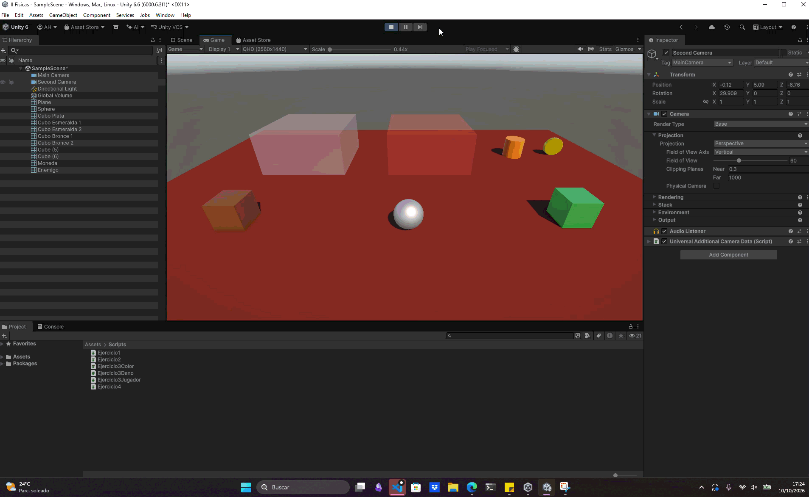

# Ejercicio 1 — Movimiento con `Rigidbody`

## Descripción

Se controla el desplazamiento de un personaje mediante las teclas **WASD** o las **flechas**. El movimiento se gestiona con un componente `Rigidbody` para que el personaje interactúe con el sistema de físicas de Unity, sin moverlo directamente mediante su `Transform`.

El script lee los ejes `Horizontal` y `Vertical` y aplica aceleración en el plano del suelo desde `FixedUpdate()`. La aceleración se puede ajustar desde el Inspector.

## Configuración

* Añade un `Rigidbody` y un `Collider` al personaje.
* Añade el script de movimiento al mismo GameObject que el `Rigidbody`.
* Comprueba que los controles `Horizontal` y `Vertical` estén asignados a WASD y las flechas en la configuración de entrada de Unity.

## Conceptos utilizados

* `Rigidbody` y `ForceMode.Acceleration`
* `Input.GetAxis()`
* `Vector3`
* `FixedUpdate()`

## Resultado

El personaje se desplaza en los ejes X y Z con el teclado y conserva las interacciones físicas proporcionadas por su `Rigidbody`.

---

### Navegación

[Volver al inicio](../../README.md) · [Ejercicio siguiente](./EJERCICIO2.md) →
