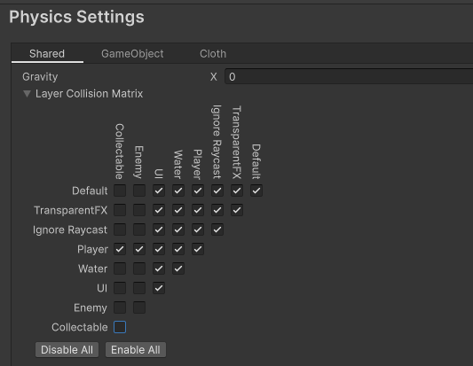
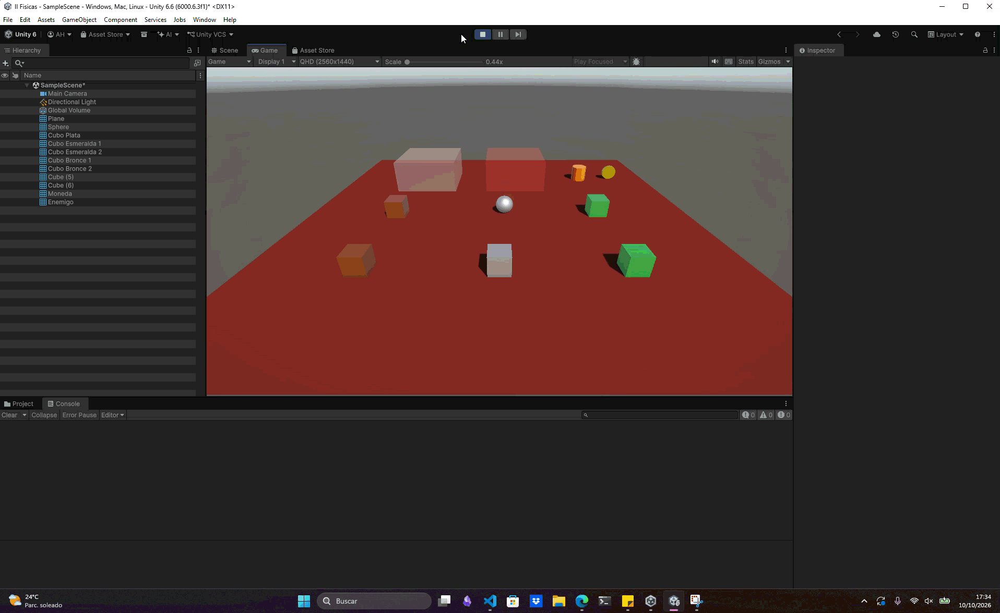

# Ejercicio 4 — Capas y matriz de colisiones

## Descripción

Se organizan los objetos en tres capas distintas: **Player** (jugador), **Enemy** (enemigos) y **Collectable** (recolectables). La interacción entre capas se configura desde **Edit > Project Settings > Physics > Layer Collision Matrix**.

La configuración debe permitir que los enemigos colisionen físicamente con el jugador, pero no con otros enemigos ni con recolectables. Los recolectables se detectan mediante triggers y no deben producir colisiones físicas.

## Configuración

1. Se crea las capas `Player`, `Enemy` y `Collectable` y asígnalas a los GameObjects correspondientes.
2. En la matriz de colisiones, se deja activada la interacción `Player`–`Enemy`.
3. Se desactivan las interacciones `Enemy`–`Enemy` y `Enemy`–`Collectable`.
4. Se conserva activa la interacción `Player`–`Collectable` para que Unity pueda enviar los eventos del trigger. Configura el collider del recolectable con **Is Trigger** para detectarlo sin una colisión física.

A continuación se expone exactamente una imagen de la matriz de colisión utilizada:

## Conceptos utilizados

* Capas de GameObjects
* Layer Collision Matrix
* `OnCollisionEnter()` y `OnTriggerEnter()`

## Resultado

El jugador detecta las colisiones con los enemigos y los triggers de los recolectables. Las parejas de capas desactivadas en la matriz no generan interacciones.

---

### Navegación

← [Ejercicio anterior](./EJERCICIO3.md) · [Volver al inicio](../../README.md) · [Ejercicio siguiente](./EJERCICIO5.md) →
