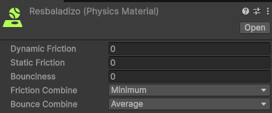
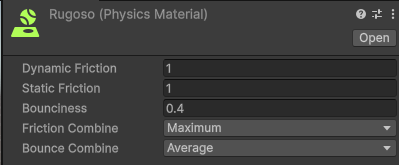
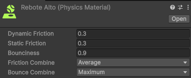
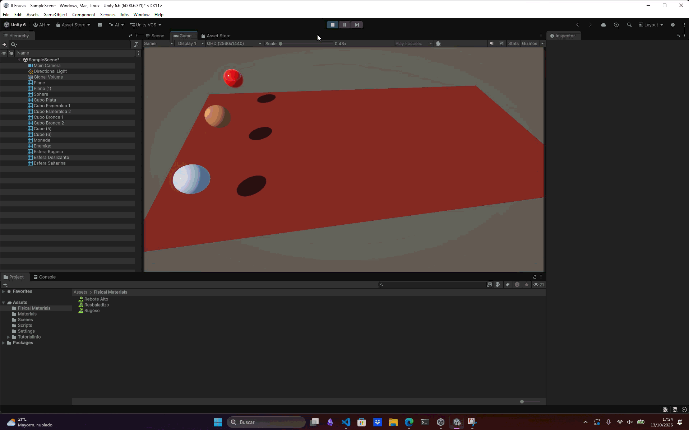

# Ejercicio 5 — Materiales

## Descripción

Se creó una escena con varias esferas que utilizan diferentes `Physic Materials` para observar cómo la fricción y el rebote afectan a su comportamiento físico.

**Resbaladizo.** Material físico que simula el hielo, con una fricción muy baja. Permite que los objetos se deslicen con mayor facilidad al entrar en contacto con una superficie.

**Rugoso.** Material físico que simula una superficie rugosa, como el corcho, con una fricción elevada y un rebote reducido. Los objetos pierden movimiento horizontal más rápidamente al rozar con otras superficies.

**Rebote alto.** Material físico que simula el comportamiento de las pelotas de plástico de juguete, con un coeficiente de rebote elevado para que los objetos reboten al chocar contra el suelo.

Para probar las distintas configuraciones, se añadieron componentes `Rigidbody` a las esferas y se asignó a cada una su correspondiente `Physic Material` desde el componente `Collider`.

Se implementó un script para detectar la pulsación de la tecla X y aplicar una fuerza mediante `AddForce()`, utilizando `ForceMode.Impulse` para lanzar los objetos.

## Configuración
A continuación se expone una imagen con cada una de las configuraciones de los materiales físicos:

**Resbaladizo**

**Rugoso**

**Rebote Alto**

## Conceptos utilizados

* `Physic Material`
* `Input.GetKey()`
* `Vector3`
* `FixedUpdate()`

## Resultado

Al pulsar la tecla X, las esferas reciben un impulso en los ejes `y` e `z` y se observa cómo reaccionan al caer y colisionar con el suelo. La esfera con material resbaladizo ofrece menor resistencia a la fricción, la esfera rugosa pierde movimiento horizontal con mayor rapidez y la esfera con rebote alto alcanza una mayor altura en sus rebotes.

---

### Navegación

← [Ejercicio anterior](./EJERCICIO4.md) · [Volver al inicio](../../README.md) · [Ejercicio siguiente](./EJERCICIO6.md) →
