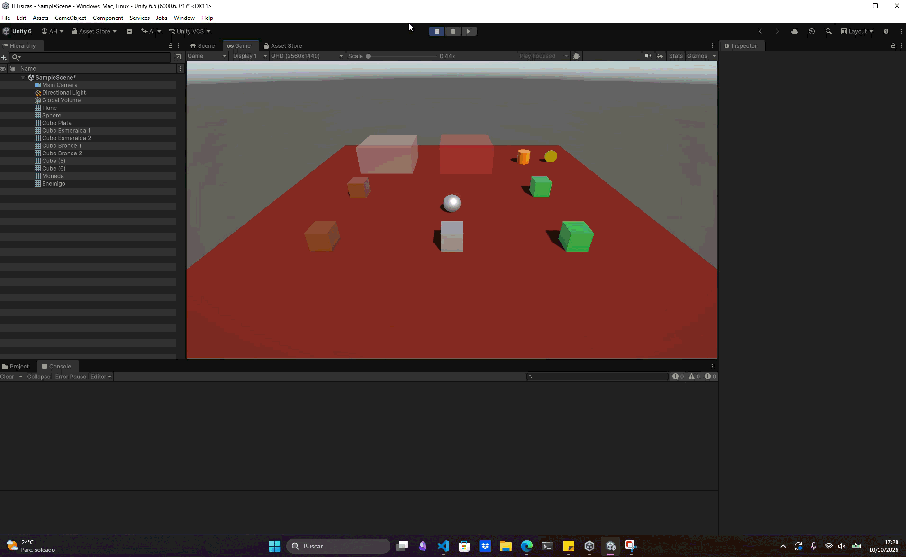

# Ejercicio 2 — Colisiones y cambio de color

## Descripción

Se preparan varios cubos o esferas con `Rigidbody` dinámicos y un `Collider`. Al colisionar con otro objeto de este grupo, se muestra en la consola el nombre del objeto con el que se ha producido la colisión y se cambia el color del objeto que recibe el impacto.

## Configuración

* Se crearon varios cubos o esferas y añade un `Collider` y un `Rigidbody` dinámico a cada uno.
* Se añadió el script de colisiones a los objetos cuyo color deba cambiar.
* Se asignó un material visible a cada objeto para poder apreciar el cambio de color.

## Conceptos utilizados

* `Rigidbody`
* `Collider`
* `OnCollisionEnter()`
* `Collision`
* `Renderer`
* `Debug.Log()`

## Resultado

Al chocar entre sí, los objetos muestran en la consola el nombre de su objeto de contacto y cambian de color.

---

### Navegación

← [Ejercicio anterior](./EJERCICIO1.md) · [Volver al inicio](../../../README.md) · [Ejercicio siguiente](./EJERCICIO3.md) →
