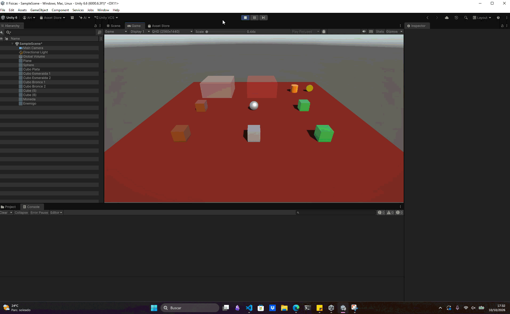

# Ejercicio 3 — Zonas de efecto y daño

## Descripción

Se crean dos zonas de detección con `Collider` configurados como **Is Trigger**:

1. **Zona de efecto:** cuando el jugador entra, cambia el color de su personaje o se activa un efecto de iluminación. Al salir, se restaura el estado anterior.
2. **Zona de daño:** cuando el jugador entra, aumenta su variable de daño. El daño puede volver a aumentar mientras el jugador permanezca dentro de la zona.

## Configuración

* Se creó un collider que abarque cada zona y marca **Is Trigger**.
* Se añaden los scripts correspondientes a cada zona.
* Se asigna la etiqueta `Player` al personaje.

## Conceptos utilizados

* `Collider`
* `OnTriggerEnter()`, `OnTriggerStay()` y `OnTriggerExit()`
* `CompareTag()`
* `Renderer`
* `Time.fixedDeltaTime`

## Resultado

El efecto visual se aplica al entrar y se revierte al salir. La zona adicional incrementa el daño del jugador al entrar y periódicamente mientras permanece en ella.

---

### Navegación

← [Ejercicio anterior](./EJERCICIO2.md) · [Volver al inicio](../../../README.md) · [Ejercicio siguiente](./EJERCICIO4.md) →
