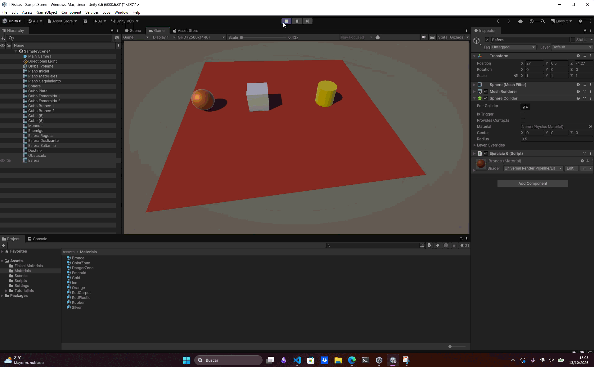

# Ejercicio 6 — Detección de contacto sin Rigidbody

## Descripción

Se creó una escena con tres objetos alineados: una esfera, un cubo y un cilindro. Cada uno dispone de un componente `Collider`, pero ninguno tiene `Rigidbody`.

- **Esfera:** objeto que se desplaza hacia el objetivo.
- **Cubo:** obstáculo situado entre la esfera y el objetivo.
- **Cilindro:** objetivo que la esfera debe alcanzar.

Se implementó un script que permite que la esfera se desplace progresivamente hacia el cilindro llamado. El cubo actúa como obstáculo entre la esfera y el cilindro. Cuando el cubo y la esfera colisionen, el material de la esfera es modificado.

## Conceptos utilizados

- `Transform`: acceso y modificación de la posición de los objetos en la escena.
- `GameObject.Find()`: búsqueda de objetos por su nombre, en este caso `Destino` y `Obstaculo`.
- `Time.deltaTime`: ajuste del movimiento al tiempo transcurrido entre fotogramas.
- `Transform.Translate()`: desplazamiento de la esfera hacia el cilindro objetivo.
- `Collider.bounds.Intersects()`: comprobación del solapamiento entre las cajas delimitadoras de dos colliders, sin necesidad de utilizar `Rigidbody`.
- `Renderer.material`: asignación de un nuevo material visual al objeto.

## Resultado

La esfera se desplaza hacia el cilindro objetivo y, al alcanzar el cubo que actúa como obstáculo, se detecta el solapamiento entre sus figuras delimitadoras (coliders). Como resultado, la esfera cambia su material visual por el material configurado en el Inspector.

---

### Navegación

← [Ejercicio anterior](./EJERCICIO5.md) · [Volver al inicio](../../../README.md)
