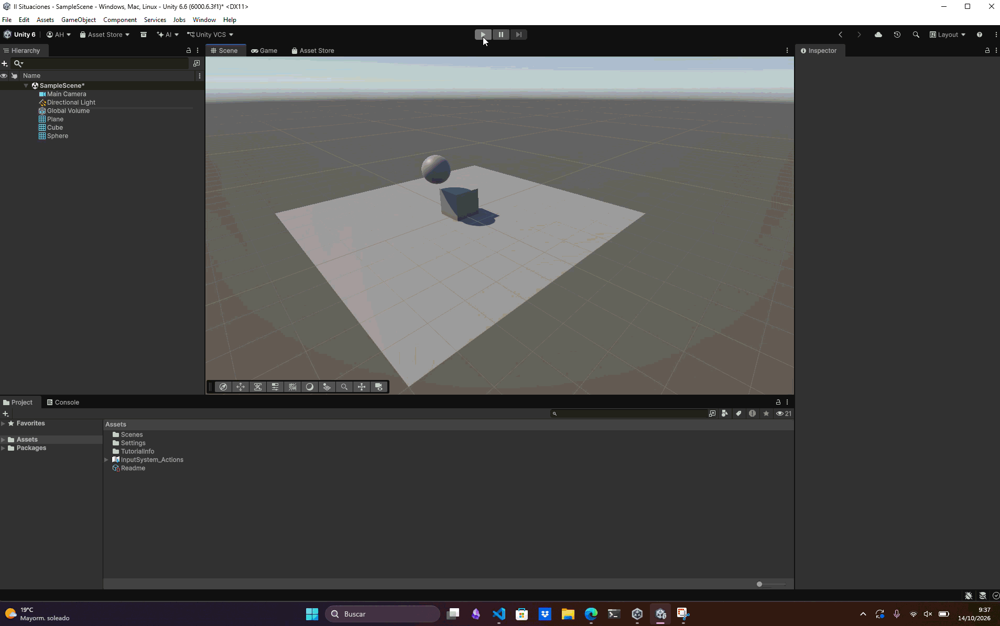

# Situación 1

## Descripción

El plano y la esfera no tienen `Rigidbody`, por lo que sus `Collider` son estáticos. El cubo sí es un objeto dinámico y debe tener `Rigidbody`.

## Resultado 

La esfera permanece inmóvil porque no tiene `Rigidbody` y, por tanto, no le afectan la gravedad ni otras fuerzas. Su `Collider` sigue detectando contactos: el cubo puede chocar con ella y cambiar su movimiento, pero no desplazarla.

---

### Navegación

[Volver al inicio](../../../README.md) · [Situación siguiente](./SITUACION2.md) →