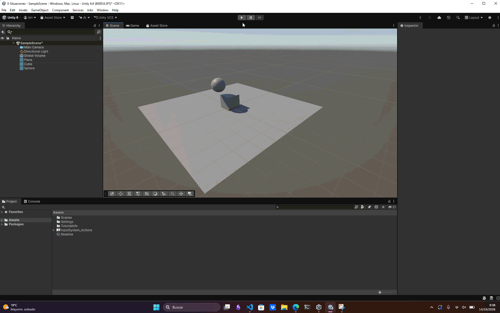

# Situación 2

## Descripción

El plano no tiene `Rigidbody` y actúa como un `Collider` estático. El cubo y la esfera son objetos dinámicos, así que ambos deben tener `Rigidbody`.

## Resultado 

La esfera y el cubo están afectados por la gravedad. Al entrar en contacto, sus `Collider` producen una colisión física: ambos pueden cambiar su movimiento según sus masas y velocidades.

---

### Navegación

← [Situación anterior](./SITUACION1.md) · [Volver al inicio](../../../README.md) · [Situación siguiente](./SITUACION3.md) →