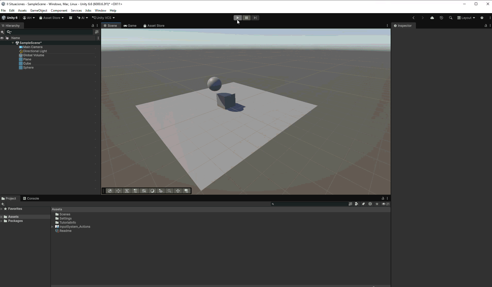

# Situación 3

## Descripción

El plano no tiene `Rigidbody` y actúa como un `Collider` estático. El cubo es dinámico y tiene `Rigidbody`; la esfera también tiene `Rigidbody`, pero con la opción `Is Kinematic` activada.

## Resultado 

La esfera cinemática no cae por efecto de la gravedad ni responde a fuerzas. Como no se le aplica movimiento mediante un script, permanece en el aire. Su `Collider` puede interactuar con el cubo dinámico y modificar su movimiento.

---

### Navegación

← [Situación anterior](./SITUACION2.md) · [Volver al inicio](../../../README.md) · [Situación siguiente](./SITUACION4.md) →