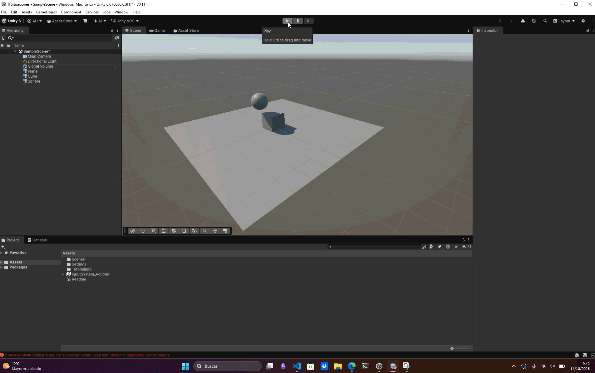

# Situación 4

## Descripción

El plano, el cubo y la esfera tienen `Rigidbody` dinámicos.

## Resultado 

La gravedad actúa sobre los tres objetos. Al caer el plano, deja de servir de superficie de apoyo y el cubo y la esfera también terminan cayendo.

---

### Navegación

← [Situación anterior](./SITUACION3.md) · [Volver al inicio](../../../README.md) · [Situación siguiente](./SITUACION5.md) →