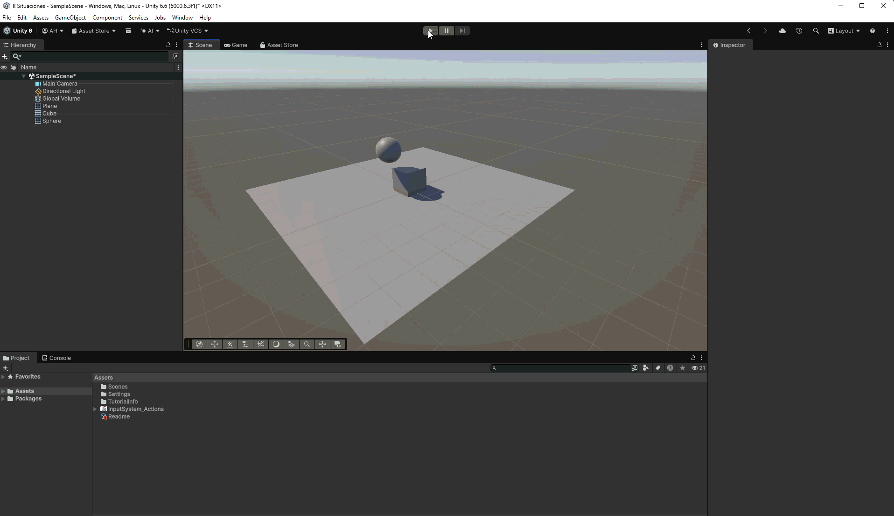

# Situación 5

## Descripción

El plano tiene un `Rigidbody` cinemático, por lo que permanece fijo. El cubo y la esfera tienen `Rigidbody` dinámicos; la esfera tiene diez veces la masa del cubo.

## Resultado 

El plano permanece fijo mientras el cubo y la esfera responden a la gravedad. Al colisionar, la diferencia de masas influye en el choque, desplazando ligeramente el cubo.

---

### Navegación

← [Situación anterior](./SITUACION4.md) · [Volver al inicio](../../../README.md) · [Situación siguiente](./SITUACION6.md) →