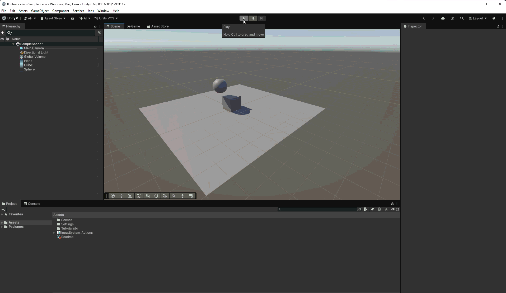

# Situación 6

## Descripción

El plano tiene un `Rigidbody` cinemático y permanece fijo. El cubo y la esfera tienen `Rigidbody` dinámicos; la esfera tiene cien veces la masa del cubo.

## Resultado 

El plano permanece fijo mientras el cubo y la esfera responden a la gravedad. Al colisionar, la diferencia de masas influye en el choque, desplazando notoriamente el cubo.

---

### Navegación

← [Situación anterior](./SITUACION5.md) · [Volver al inicio](../../../README.md) · [Situación siguiente](./SITUACION7.md) →