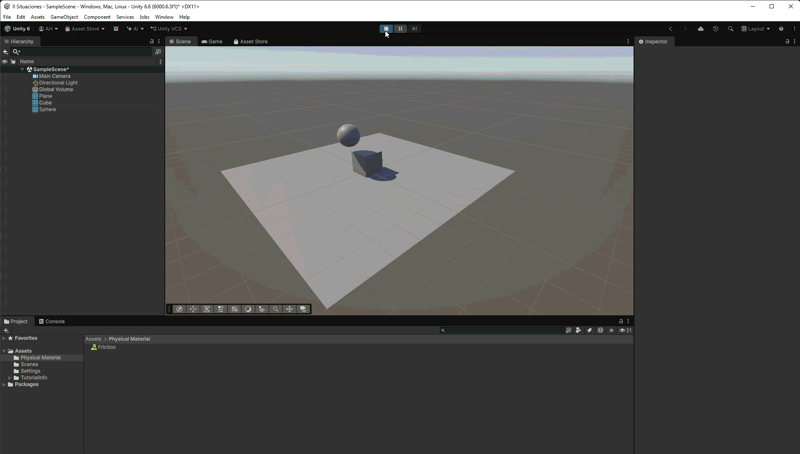

# Situación 7

## Descripción

El plano, el cubo y la esfera tienen `Rigidbody` dinámicos. La esfera utiliza un material físico (`Physic Material`) con fricción.

## Resultado 

La fricción del material de la esfera afecta al deslizamiento cuando entra en contacto con otra superficie, afectando principalmente a la velocidad con la que se desliza por el plano.

---

### Navegación

← [Situación anterior](./SITUACION6.md) · [Volver al inicio](../../../README.md) · [Situación siguiente](./SITUACION8.md) →