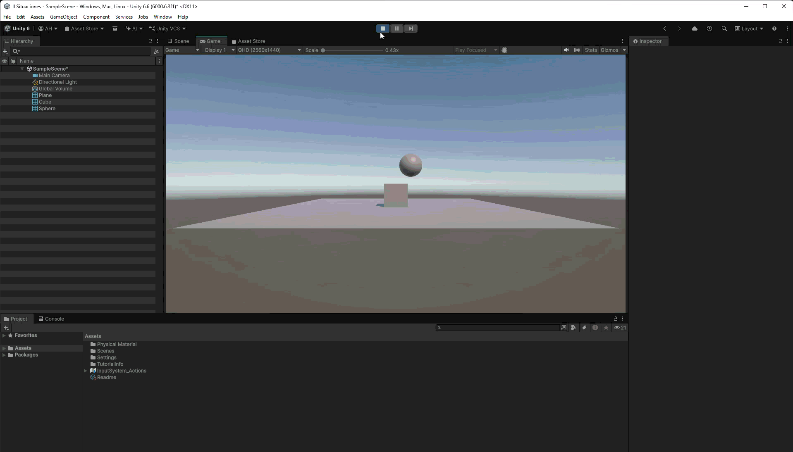

# Situación 8

## Descripción

El plano tiene un `Rigidbody` cinemático y permanece fijo. El cubo tiene un `Rigidbody` dinámico. La esfera no tiene `Rigidbody` y su `Collider` tiene activada la opción `Is Trigger`.

## Resultado 

La esfera permanece inmóvil porque es `Kinematic`, a pesar de tener `Rigidbody`.

---

### Navegación

← [Situación anterior](./SITUACION7.md) · [Volver al inicio](../../../README.md) · [Situación siguiente](./SITUACION9.md) →