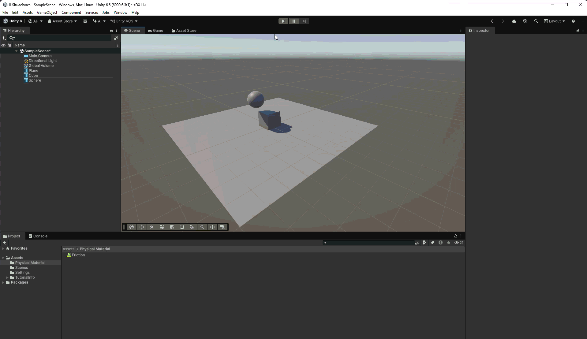

# Situación 9

## Descripción

El plano tiene un `Rigidbody` cinemático y permanece fijo. El cubo y la esfera tienen `Rigidbody` dinámicos; el `Collider` de la esfera tiene activada la opción `Is Trigger`.

## Resultado 

La gravedad afecta tanto al cubo como a la esfera. Aunque ambos tienen `Rigidbody`, el `Trigger` de la esfera no genera una colisión física: detecta el paso del cubo, pero no lo empuja ni lo frena. Lo mismo ocurre con el plano.

---

### Navegación

← [Situación anterior](./SITUACION8.md) · [Volver al inicio](../../../README.md)